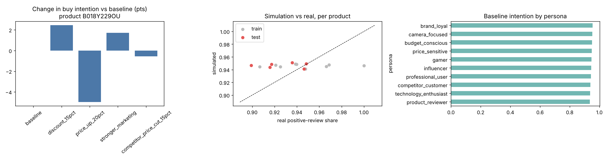
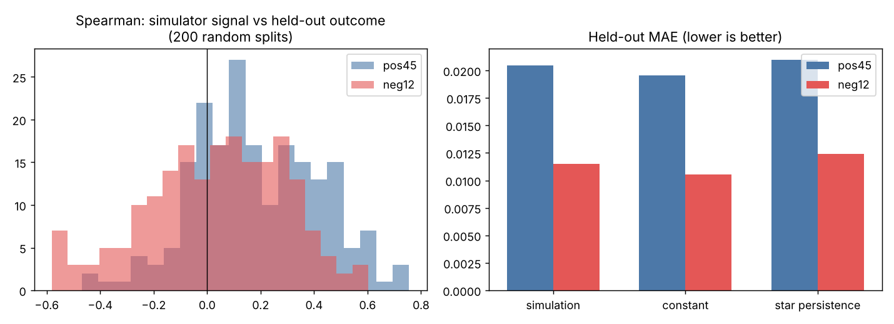
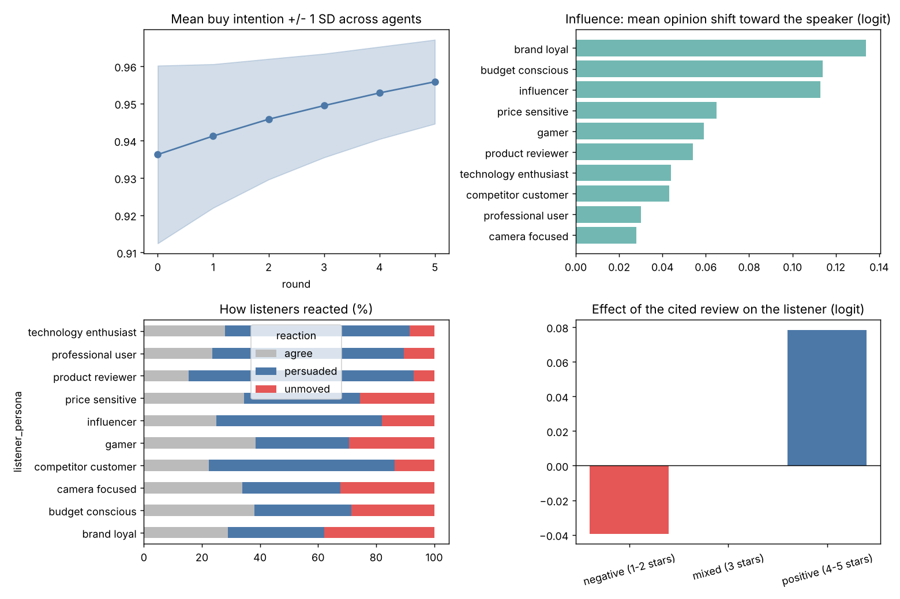

# MiroFish-Style Multi-Agent Simulation of Consumer Response to Product Launches

*An AI Lab project (M.Tech) by Tusha Mishra, Nancy Patel and Manan Patel.*

**In one paragraph.** When a company launches a product, customers do not react as one block: a bargain hunter, a gamer and a loyal fan see the same price very differently, and they influence each other. This project builds a small, inspectable version of that idea. It takes about 60,000 real Amazon product reviews, turns them into ten data-calibrated consumer personas, lets simulated agents read real reviews and talk to each other, and compares launch scenarios such as a discount, a price rise, more marketing or a competitor price cut. It then tests, as honestly as the data allows, whether the simulator predicts anything. **Spoiler: it does not yet, and this repository explains exactly why.**

---

## Findings and Summary

* **The pipeline works end to end** on real data: raw files, one audited review table, aspects, retrieval, personas, simulation, scenarios, agent conversations, evaluation, dashboard.
* **Scenario behaviour is sensible but assumed.** A discount raises simulated buy intention, a price rise lowers it. The *sizes* come from assumed parameters because the review data contains **no prices and no sales**.
* **The simulator does not beat a plain average** at predicting held-out product outcomes, and neither does a product's own star rating. In this very positive dataset (92% of reviews are 4-5 stars) product differences are mostly noise.
* **The agent conversations are fully traceable.** Every statement cites a real review and every opinion change can be recomputed from logged terms. That shows *explainability*, not real-world accuracy.
* **Data quality finding:** about half of all reviews sit on product IDs (ASINs) that carry several different product titles, so product categories are assigned from each review's own title.

We treat the system as an **exploratory scenario tool with explicit assumptions**, not a validated sales predictor. Milestone 2 describes what is needed for a real predictive claim.

---

## Repository layout

```
mirofish-consumer-simulation/
├── README.md                  <- you are here
├── requirements.txt           <- Python packages (with notes on what is deliberately NOT needed)
├── .gitignore                 <- keeps raw/generated data out of Git
├── notebooks/                 <- the story, step by step, with methods and reasons in markdown
│   ├── 01_data_inventory_and_merge.ipynb
│   ├── 02_knowledge_layer_and_personas.ipynb
│   ├── 03_simulation_and_scenarios.ipynb
│   ├── 04_evaluation.ipynb
│   └── 05_agent_conversations.ipynb
├── src/                       <- the code (every module explains its methods and why in its docstring)
│   ├── inventory.py           <- Phase 1: hash, profile and inventory the raw files
│   ├── merge.py               <- Phase 2: canonical tables, de-duplication, audit trail
│   ├── knowledge.py           <- Phase 3: category, aspects, BM25 retrieval, graph, personas
│   ├── simulate.py            <- Phases 4-7: agents, simulation, scenarios, first evaluation
│   ├── evaluate.py            <- Phase 7b: leakage-free split-half evaluation
│   ├── conversations.py       <- agent-to-agent conversations + reasoning analysis
│   ├── loaders.py             <- shared data loading and calibration
│   └── app.py                 <- Gradio dashboard
├── tests/test_smoke.py        <- small tests for the pure functions
├── data/raw/                  <- put the three Datafiniti CSV files here (not committed)
└── docs/results/              <- figures and tables from our own run
```

---

## Quick start

**1. Get the code and install packages**
```bash
git clone https://github.com/Xcode-Nancy/mirofish-consumer-simulation.git
cd mirofish-consumer-simulation
python -m pip install -r requirements.txt
```

**2. Add the data.** Copy the three Datafiniti "Consumer Reviews of Amazon Products" CSV files into `data/raw/` (see `data/raw/README.md`).

**3. Run it: either notebooks or scripts.**

*Notebooks (recommended: they explain every step).* Open `notebooks/` in Jupyter or VS Code and run `01` to `05` in order.
Colab: open a notebook from GitHub, run `!git clone ...`, `%cd mirofish-consumer-simulation`, `!pip install -r requirements.txt`, upload the CSVs to `data/raw/`, then run the notebook.

*Scripts (one command at a time, from the repository folder):*
```bash
python src/inventory.py --raw-dir data/raw --project-dir .
python src/merge.py --project-dir .
python src/knowledge.py --project-dir . --category fire_tablet --list-price 49.99
python src/simulate.py --project-dir .
python src/evaluate.py --project-dir .
python src/conversations.py --project-dir . --append-report
python src/app.py --project-dir .        # dashboard at http://127.0.0.1:7860
python -m pytest -q tests                # optional: run the tests
```
On Windows use `python` (or the full path to your Python) exactly as above. Run the commands one at a time; pasting two on one line breaks them.

---

## How it works, and why we chose each method

```
raw reviews -> inventory -> canonical merge -> category + aspects -> retrieval index + graph + personas
            -> agents -> simulation + scenarios -> conversations -> evaluation -> report + dashboard
```

| Stage | Method | Why we chose it | Limitation we accept |
|---|---|---|---|
| Inventory | SHA-256 hash of raw files; raw files never edited | Proves the data was not altered; every later step is repeatable | None worth noting |
| Merge | Schema mapping; `concat` for the same logical table; validated many-to-one join | One documented translation; a join can never silently multiply rows | Product IDs stay unreliable (see below) |
| De-duplication | Exact key (product, user, normalised text) with a `found_in_sources` provenance column | Conservative: no fuzzy guessing that could merge different reviews | Misses near-duplicate text |
| Determinism | Stable sort before dropping duplicates; one CSV format everywhere | Earlier, ties and Parquet-vs-CSV gave different counts on different machines | - |
| Category | From each review's own title; accessories checked first | About half of the reviews sit on IDs with several titles | Keyword rules can misfile odd titles |
| Aspects | 14-aspect keyword lexicon | Transparent, editable, needs no labelled data | Misses paraphrases |
| Sentiment | Word list + negation window + star-rating fallback | Fast and explainable; keeps neutral sentences usable | Fallback makes part of it star-derived (hence the split-half test) |
| Retrieval (RAG) | BM25 in plain numpy | Strong, interpretable baseline; avoids scikit-learn, which has no build for the newest Python | Lexical only; embeddings planned |
| Knowledge graph | Product-to-aspect edges in JSON | Stores only evidence-backed relations | Small graph |
| Personas | Keyword clusters; influencer = top 10% helpful votes; reviewer = top 10% length; `LOW DATA` flag under 30 reviews | Weights and shares are computed, not invented | Personas overlap; synthetic groups, not people |
| Agents | Sampled from personas with random noise on aspect weights | Heterogeneity is the project's core idea | Noise level is a modelling choice |
| Product score | Shrinkage toward the category mean (n0 = 10) | Thin products do not get extreme, noisy scores | n0 is a choice |
| Decision rule | Logistic (sigmoid) in logit space | Bounded 0 to 1, smooth, every term meaningful | - |
| Price effect | Constant elasticity: `-e x log(price multiplier)` | Standard demand form | **Elasticity is assumed** (no prices in the data) |
| Peer influence | Influence-weighted crowd average (DeGroot-style) | Simple, well known, explainable | No real network structure |
| Conversations | Random pairing; speaker cites a real retrieved review; explicit update rule | Every statement is grounded and every change auditable | Update-rule weights are assumed; templates unless an LLM is used |
| Evaluation | Split-half, leave-one-product-out, 200 random splits, constant and star-rating baselines | Removes leakage; baselines show what is achievable | Only ~12 products have enough reviews |
| Dashboard | Gradio | Named in the proposal; sliders and tabs with no front-end code | Local demo, not a hosted service |

---

## Results

**Data.** 67,992 raw rows in three overlapping files became **60,872 unique reviews of 91 product IDs**. We focus on **Fire tablets: 19,133 reviews**. Full step-by-step counts: `docs/results/merge_audit.csv`.

**Scenarios** (simulated buy intention for the largest product; sizes are driven by assumed parameters):

| Scenario | Buy intention | Change vs baseline (points) |
|---|---|---|
| baseline | 94.5% | +0.00 |
| discount 15pct | 96.9% | +2.47 |
| price up 20pct | 89.5% | -4.98 |
| stronger marketing | 96.2% | +1.73 |
| competitor price cut 15pct | 93.9% | -0.55 |



**Leakage-free evaluation** (12 products with at least 100 reviews, 200 random splits). Lower error is better:

| | 4-5 star share | 1-2 star share |
|---|---|---|
| Error (MAE), simulator | 0.0205 | 0.0115 |
| Error (MAE), constant average | 0.0196 | 0.0106 |
| Error (MAE), product's own star rating | 0.0210 | 0.0124 |
| Splits where the simulator beats the constant | 26% | 9.5% |
| Rank correlation, simulator (5-95% range) | 0.18 (-0.18 to 0.58) | 0.03 |



*How to read it:* the simulator does not improve on a constant average, and neither does a product's own star rating. Most of the spread between products is what chance alone would produce, so this is a limit of the data as much as of the model. The notebook `04_evaluation.ipynb` shows the noise calculation.

**Agent conversations.** 2,000 logged exchanges: 50% persuaded the listener, 29% were agreements, 20% left the listener unmoved. Mean buy intention moved from 93.6% before the conversations, 95.6% after. Part of that upward drift is the positive skew of the cited reviews, not a real effect (explained in the generated report). Every message cites a retrieved real review (100%), and every opinion update is reproducible from its logged terms.



The full generated section is in `docs/results/conversation_report.md`.

---

## The dashboard

`python src/app.py --project-dir .` opens a local web page with five tabs:

* **Simulate:** pick a product and move sliders for our price, marketing, competitor price, number of agents and a random seed.
* **Agent conversations:** read the exchanges between agents round by round, filtered by round and persona. Each shows what the speaker said, the listener's reply, and the reasoning numbers.
* **Reasoning analysis:** integrity checks, who influences whom, which topics drive the conversations, and the effect of the evidence cited.
* **Evaluation:** the leakage-free evaluation, shown next to the demo on purpose.
* **Report:** the generated report.

An optional LLM can phrase the agents' replies: set `LLM_API_KEY`, `LLM_BASE_URL` and `LLM_MODEL` (any OpenAI-compatible endpoint, such as a hosted Qwen model) and tick the checkbox. Without a key everything falls back to templates, which are built only from the logged numbers.

---

## Data

* **Source:** Datafiniti "Consumer Reviews of Amazon Products" (three overlapping files, 2009 to 2019).
* **Not included:** the raw files are large and their redistribution terms are **not yet verified**. The source URL and license fields in `data/source_registry.csv` are marked `NOT VERIFIED`; fill them in from the page you downloaded from.
* **No price, discount or sales columns exist.** The `--list-price` option is an assumption to be replaced by a verified, cited value.

---

## Assumptions and limitations

* Price, marketing and competitor effects are **assumed parameters**, not learned (price elasticity 2.5, marketing boost 0.5, competitor switching 2.0; conversation credibility and evidence weights).
* Ground truth is **review satisfaction among buyers**, not the purchase intention of a whole market.
* **Strong positive skew** leaves little to explain and compresses scenario effects.
* **Few products** with enough reviews, and ASIN-level products can mix several real products.
* **Simple language processing:** keyword aspects and a small sentiment word list.
* **No LLM by default:** decisions are rule-based; sentences are templates.
* **Personas are synthetic** groups defined by what people wrote. No demographics were used or invented.

---

## Reproducibility

* All random choices use fixed seeds (`--seed`); the review table and the review IDs are deterministic.
* The pipeline writes **CSV only**. We learned that mixing Parquet and CSV changed category counts between machines, so do not install `pyarrow` if you want identical numbers.
* Small numeric differences (the third decimal) can still appear across Python and library versions.
* Tested on Python 3.12 (Linux sandbox) and 3.14 (Windows, the authors' machine). If `pip install gradio` fails on a very new Python, use Python 3.12 or 3.13 in a virtual environment.

---

## Roadmap: Milestone 2

1. **Real prices and an outside demand signal** (sales rank or review volume over time) so price effects can be fitted, not assumed.
2. **LLM-driven agents** (for example Qwen) compared with the rule-based agents, with repeated runs to measure variability.
3. **Better product identity:** merge variant IDs into reliable product groups.
4. **Semantic retrieval** (embeddings) behind the same `Retriever.search()` interface.
5. **More informative evaluation:** outcomes with more variation, time-based splits and more products.
6. **Other interaction networks** (homophily, influencer-centred) as experimental variables.

---

## References

* MiroFish: *A Simple and Scalable Swarm Intelligence Engine* (GitHub repository), the inspiration for the overall pipeline.
* Park, O'Brien, Cai, Morris, Liang, Bernstein (2023). *Generative Agents: Interactive Simulacra of Human Behavior.* UIST 2023.
* Park et al. (2024). *Generative Agent Simulations of 1,000 People.*
* Li et al. (2023). *CAMEL: Communicative Agents for "Mind" Exploration of Large Language Model Society.* arXiv:2303.17760.
* Wu et al. (2023). *AutoGen: Enabling Next-Gen LLM Applications via Multi-Agent Conversation.* arXiv:2308.08155.
* Liu et al. (2023). *AgentBench: Evaluating LLMs as Agents.* ICLR 2024.
